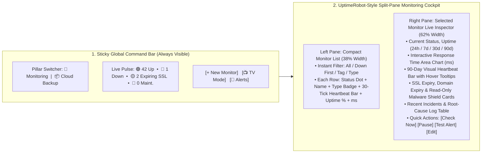

# SiteVaulta 2.0 — UptimeRobot Competitive Analysis, Complete Feature Specification & Long-Session UX Blueprint

> **Strategic Goal**: Transform **SiteVaulta** into a unified **Two-Pillar SaaS Platform**:
> 1. **📡 Pillar 1: Enterprise Uptime, Performance & Security Monitoring** (100% feature parity with **UptimeRobot.com** + our exclusive **100% Read-Only Malware & Web-Shell Scanner**).
> 2. **📦 Pillar 2: Zero-Lock-In BYOS Cloud Backup & 1-Click Disaster Recovery** (Our core differentiator that UptimeRobot does not have).

---

## 1. Honest Gap Analysis: Why Our Current Monitoring & UX Is Not Ready Yet

Before writing a single line of new code, we must acknowledge the exact gaps between our current system and **UptimeRobot (`https://uptimerobot.com/`)**:

| Area | Current State in SiteVaulta | UptimeRobot Standard (What We Must Build) |
| :--- | :--- | :--- |
| **Product Architecture** | Monitoring is buried inside the `Websites` CRUD table as extra columns and a modal. | A dedicated **Monitoring Command Center** with its own navigation (`Monitors`, `Incidents`, `Status Pages`, `Maintenance`, `Alert Contacts`, `TV Mode`). |
| **Long-Session UX** | Standard Filament table rows; requires clicking modals to see details; tiring for long use. | **Split-Pane / Single-Page Reactive Workspace**: Left/Main list with live **90-Tick Green/Red Heartbeat Bars**, instant search/tag filters (`Down First`), and a rich **Monitor Detail View** with live **Response Time Graphs (`ms`)**. |
| **Historical Data & SLA** | Only stores the *latest* status on the `websites` row (`uptime_status`, `last_response_time_ms`). No history! | Time-series **`monitor_checks`** and **`monitor_incidents`** tables storing every check, calculating true **24h / 7d / 30d / 90d / 365d Uptime %** (e.g., `99.98%`) and **Avg / Min / Max Response Time**. |
| **Monitor Types** | Only basic HTTP + Server port check tied to a backup website. | **9 Dedicated Monitor Types**: `HTTP(s)`, `Keyword (Exists/Missing)`, `Ping (ICMP)`, `Port (TCP/UDP)`, `Cron Job / Heartbeat`, `DNS Records`, `API / JSON Payload`, `SSL & Domain Expiry`, and `Read-Only Malware`. |
| **Incident Management** | Sends an email when down, but has no dedicated incident log or duration tracking. | Dedicated **Incidents Engine**: tracks `Started At`, `Resolved At`, exact `Duration (e.g. 14m 22s)`, `Root Cause / HTTP Response Snapshot`, and team post-mortem comments. |
| **Public Status Pages** | None. | Shareable **Public/Private Status Pages** (`/status/{slug}` + Custom Domain `status.agency.com`), 90-day uptime bars, incident announcements, and customer email subscriptions. |
| **Maintenance Windows** | None (server reboots trigger false downtime alerts). | Scheduled **One-Time & Recurring Maintenance Windows** that pause alerts and protect SLA Uptime % during planned updates. |

---

## 2. Complete Feature Breakdown of UptimeRobot (`uptimerobot.com`)

To compete head-to-head with UptimeRobot, we must support every single capability their users rely on:

### 2.1 All 9 Monitor Types + Auxiliary Guards

1. **🌐 HTTP(s) Website & Endpoint Monitor**
   - Periodically requests any `http://` or `https://` URL.
   - Verifies expected HTTP status codes (default `2xx`, or custom `200, 201, 301, 401`).
   - Records **Response Time (`ms`)**, TTFB, redirect chain count, and response headers.
2. **🔍 Keyword Monitor (Content Verification)**
   - Inspects the raw HTML/text body of a page.
   - Two modes:
     - **Alert if Keyword Is Missing** (e.g., check that `"Add to Cart"` or `"Daffodil International University"` is present—catches blank white pages or silent DB errors that still return `HTTP 200`).
     - **Alert if Keyword Exists** (e.g., alert immediately if `"Fatal error"`, `"502 Bad Gateway"`, or `"Error establishing a database connection"` appears on the page).
   - Case-sensitive or case-insensitive matching.
3. **📶 Ping (ICMP / Host Reachability) Monitor**
   - Pings any IPv4/IPv6 address or hostname to verify server-level network reachability and latency (`ms`) even if no web server is running.
4. **🔌 Port Monitor (TCP / UDP Services)**
   - Probes any specific port to verify that the underlying daemon is alive and accepting connections:
     - Presets: `SSH (22)`, `FTP (21)`, `SMTP (25/465/587)`, `HTTP (80)`, `HTTPS (443)`, `cPanel/WHM (2083/2087)`, `MySQL (3306)`, `PostgreSQL (5432)`, `Redis (6379)`, or any **Custom Port (`1–65535`)**.
5. **💓 Cron Job / Heartbeat Monitor (Reverse Monitoring)**
   - Generates a unique inbound webhook URL: `https://sitevaulta.com/heartbeat/{monitor_token}`.
   - The user adds `curl -fsS https://sitevaulta.com/heartbeat/{token}` at the end of their server's cron job, queue worker, or internal script.
   - Configures **Expected Interval** (e.g., every `60 minutes`) + **Grace Period** (e.g., `10 minutes`). If no ping arrives in time, SiteVaulta triggers a Down Incident.
6. **🧭 DNS Record Monitor**
   - Monitors `A`, `AAAA`, `CNAME`, `MX`, `NS`, and `TXT` records against expected values.
   - Alerts immediately if DNS records are hijacked, modified, or fail to resolve.
7. **⚡ API & JSON Assertion Monitor**
   - Sends `GET`, `POST`, `PUT`, `PATCH`, or `DELETE` requests with custom JSON/Form payloads and custom headers (`Authorization: Bearer ...`).
   - Validates JSON path assertions (e.g., `$.status == "healthy"` or `$.db_connected == true`).
8. **🔒 SSL Certificate & Domain WHOIS Expiry Guard**
   - **SSL Guard**: Inspects TLS certificate chain, Issuer Authority, Subject SANs, protocol version (`TLSv1.2` / `TLSv1.3`), and fires reminders at configurable thresholds (`30`, `14`, `7`, `3`, `1` days before expiry).
   - **Domain Expiry Guard**: Tracks domain registration expiration date so domains never accidentally expire.
9. **🛡️ SiteVaulta Exclusive: 100% Read-Only Malware, Web-Shell & Exposure Monitor**
   - Non-destructive scan for PHP web-shells (`c99`, `r57`, `WSO`, `b374k`), obfuscated backdoors (`eval(base64_decode)`), and exposed `/.env`, `/.git/config`, `/phpinfo.php`, or `/backup.sql` endpoints—reporting exact file paths with **zero file modification or deletion**.

---

### 2.2 Advanced Monitor Configuration (Zero False-Alarm Engine)

UptimeRobot users love its fine-grained controls that prevent false alarms:
- **Configurable Check Intervals**: `30 seconds`, `1 minute`, `2 minutes`, `5 minutes`, `10 minutes`, `30 minutes`, `1 hour`.
- **Confirmation / Retry Threshold (Anti-Flap)**: Require **1 to 5 consecutive failures** (or immediate retry after 5 seconds) before marking a monitor as `DOWN` and sending alerts.
- **Custom Request Timeout**: Slider from `5 seconds` to `60 seconds` (Plus **Slow Response Alert**: warn if response time exceeds e.g. `2,000 ms` even if status is `200 OK`).
- **Custom HTTP Authentication & Headers**:
  - HTTP Basic Auth (`username:password`) or Bearer Token.
  - Custom `User-Agent` and arbitrary key-value HTTP headers.
  - Option to follow redirects (`max 5 hops`) or treat `301/302` as final status.
  - Option to verify or ignore self-signed SSL certificates.
- **Tags, Groups & Priority**:
  - Assign color-coded tags (`Production`, `Client: Daffodil`, `Database`, `Critical`) and group monitors by project or client.

---

### 2.3 Incident Lifecycle & Root-Cause Diagnostics

When a monitor fails, UptimeRobot creates a structured **Incident Record**:
- **Incident States**: `🔴 Ongoing (Unresolved)`, `🟡 Acknowledged / Investigating`, `🟢 Resolved`.
- **Precise Timeline Metrics**:
  - `Started At` (exact timestamp)
  - `Resolved At` (exact timestamp)
  - `Total Duration` (human-readable + exact seconds, e.g., `18m 42s`)
- **Root-Cause Diagnostic Snapshot**:
  - Exact error code (`HTTP 503 Service Unavailable`, `cURL 28: Connection timed out after 15000ms`, `Keyword "Checkout" missing in 42KB response`, `Port 3306 Connection Refused`).
  - Stores the first 2 KB of response headers/body (sanitized) so developers can see *why* the server failed even if it recovered 2 minutes later.
- **Team Incident Notes & Post-Mortem**:
  - Team members can add timestamped notes (e.g., *"Restarted PHP-FPM on node-2; investigating memory spike"*) and optionally publish the update to the Public Status Page.

---

### 2.4 Public & Private Status Pages (UptimeRobot's Flagship Feature)

Agencies and SaaS companies use UptimeRobot Status Pages to build trust with clients:
- **Instant Hosted URL**: `/status/{custom-slug}` (plus optional CNAME Custom Domain support like `status.yourdomain.com`).
- **Visual Components on the Status Page**:
  - **Global System Banner**:
    - `🟢 All Systems Operational`
    - `🟡 Partial System Degradation`
    - `🔴 Major Service Outage`
    - `🔵 Scheduled Maintenance in Progress`
  - **Service Groups & 90-Day Green/Yellow/Red Uptime Bars**:
    - Each monitor shows its name, current status badge, **90-Day Uptime % (`99.98%`)**, and an interactive 90-bar daily timeline where hovering any day shows that day's uptime % and incident count.
  - **Optional Live Response Time Sparkline**: Show or hide `ms` latency graphs per monitor.
  - **Scheduled Maintenance & Incident History Feed**: Shows past 14/30 days of incidents and upcoming maintenance windows.
- **Customization & Access Control**:
  - Custom Brand Logo, Favicon, Primary Accent Color, Dark/Light theme default, and White-Label mode (hide "Powered by SiteVaulta").
  - **Privacy Modes**: Public, Password-Protected (for internal/client-only status pages), or IP-restricted, plus `noindex` toggle.
  - **Client Email Subscriptions**: Visitors can click **"Subscribe to Updates"** on the status page to receive automatic emails when an incident starts or resolves.

---

### 2.5 Maintenance Windows (SLA & Alert Protection)

- **One-Time Window**: e.g., `2026-11-15 02:00 AM – 04:00 AM (Asia/Dhaka)`.
- **Recurring Window**: Daily, Weekly (e.g., `Every Sunday 03:00 AM for 30 mins`), or Monthly.
- **Behavior**:
  - Automatically switches linked monitors to `🔵 Maintenance` status during the window.
  - Suppresses false-alarm Down emails/notifications during the window.
  - Excludes scheduled maintenance minutes from the monitor's SLA Uptime % calculation.

---

### 2.6 Multi-Channel Alert Contacts & Escalation Rules

- **Supported Channels**:
  1. **Smart Email Routing** (Our unique advantage: **Free Custom SMTP ⇄ System Email Digital Wallet Auto-Fallback**).
  2. **In-App Real-Time Database Bell (`🔔`)** with sound/toast option.
  3. **Telegram Bot** (1-click Chat ID + Bot Token test).
  4. **Slack & Discord Webhooks** (Rich color-coded embed cards).
  5. **Microsoft Teams & Custom Outbound Webhook (JSON POST)**.
- **Smart Alert Rules (Escalations)**:
  - *Send alert when*: Down immediately (`0m`), or only if down for `> X minutes`.
  - *Repeat alert*: Every `X minutes` (up to `N` times) until resolved or acknowledged.
  - *SSL & Domain Expiry Reminders*: Send at `30, 14, 7, 3, 1` days remaining.

---

## 3. Long-Session UX Architecture: Designing a UI Users Love to Keep Open All Day

You rightly pointed out that **our current UX is a standard admin CRUD table, not a monitoring cockpit that users enjoy using for hours**. Here is why UptimeRobot's UX works so well for long sessions—and how we will design ours:

### Key UX Principles We Will Implement:

1. **Two-Pillar Navigation Separation (Clean & Zero Clutter)**
   - In the sidebar/topbar, the user sees two crystal-clear worlds:
     - **📡 Monitoring (UptimeRobot Suite)**:
       1. `Monitors (Live Cockpit)`
       2. `Incidents & Outages`
       3. `Status Pages`
       4. `Maintenance Windows`
       5. `Alert Contacts & Channels`
     - **📦 Cloud Backups (Vault Suite)**:
       1. `Websites & Verification`
       2. `Server Connections`
       3. `Storage Destinations`
       4. `Backup Policies & Schedules`
       5. `Backup Runs & Restore`
     - **💳 Workspace & Billing**:
       1. `Email Wallet & Referrals`
       2. `Plans & Subscription`
       3. `Workspace Settings`

2. **The UptimeRobot Split-Pane "Monitors Cockpit" (Zero Page Reloads)**
   - Instead of a wide, hard-to-read Filament table with 10 columns, the **Monitors** page uses a **2-Pane Interactive Cockpit**:
     - **Top Summary Bar**: Shows `🟢 X Online`, `🔴 Y Down`, `⏸️ Z Paused`, `📊 Global 24h Uptime: 99.98%`, Search Input, Tag Filter, and Sort (`Down First`, `Slowest First`, `A–Z`).
     - **Left List**: Compact, high-density cards. Every monitor row shows:
       - Pulsing Green/Red Status Indicator
       - Monitor Name & Type (`HTTP`, `KEYWORD`, `PORT:3306`, `HEARTBEAT`, `SSL`)
       - **30-Tick Green/Red Mini Heartbeat Bar** (visual history at a glance!)
       - Current Response Time (`142ms`) & 24h Uptime (`100%`)
     - **Right Inspector Panel**: Clicking any monitor on the left instantly loads its full analytics on the right without leaving the page:
       - **60/90-Tick Full Heartbeat Bar** with hover tooltips (`Time`, `Status`, `Latency ms`).
       - **Uptime SLA Cards**: `Last 24h`, `Last 7d`, `Last 30d`, `Last 90d`.
       - **Interactive Response Time Chart (`ms`)**: Smooth SVG/Canvas area chart showing `Avg`, `Min`, and `Max` response speed over time.
       - **Security & Certificate Strip**: SSL Days Left, Domain Status, and 100% Read-Only Malware Scan status.
       - **Incident History Table**: Every past outage with start time, end time, duration, and root-cause error code.

3. **📺 1-Click Fullscreen "TV / Wallboard Mode" (For Long-Session Monitoring)**
   - Clicking **`📺 TV Mode`** opens a distraction-free, high-contrast dark wallboard that auto-refreshes every 15 seconds, sorting any `DOWN` or `SLOW` monitor to the top with an optional audio alert chime—designed to stay open 24/7 on a developer's second screen or agency office TV.

4. **Seamless Bridge Between Monitoring & Backup (Our Secret Weapon)**
   - In UptimeRobot, you have to add all your websites from scratch.
   - In SiteVaulta, you can **1-Click Import from Verified Websites** OR create standalone monitors for any external URL, IP, Port, API, or Cron Job even if it isn't backed up!

---

## 4. Database Schema Blueprint for the Monitoring Engine

To power true UptimeRobot-grade historical analytics without slowing down the database, we will create 6 clean, indexed tables:

1. **`monitors`**
   - `id`, `uuid`, `workspace_id`, `website_id` (nullable — can link to a backup website or be standalone!)
   - `name`, `group_name`, `tags` (JSON)
   - `type` (`http`, `keyword`, `ping`, `port`, `heartbeat`, `dns`, `api`)
   - `target` (URL, IP, or Hostname), `port` (nullable), `http_method` (`GET`, `POST`, etc.)
   - `keyword_value`, `keyword_should_exist` (boolean)
   - `expected_status_codes` (`200-299`), `custom_headers` (encrypted JSON), `auth_username`, `auth_password`
   - `interval_seconds` (`60`, `300`, etc.), `timeout_seconds` (`15`), `confirmation_threshold` (`2`), `slow_response_threshold_ms` (`2000`)
   - `heartbeat_token` (unique), `heartbeat_grace_seconds`
   - `check_ssl_expiry` (bool), `ssl_expiry_remind_days` (`30,14,7,3`), `check_read_only_malware` (bool)
   - `status` (`up`, `down`, `degraded`, `paused`, `maintenance`)
   - `consecutive_failures`, `last_checked_at`, `last_status_changed_at`, `last_response_time_ms`
   - `uptime_24h`, `uptime_7d`, `uptime_30d`, `uptime_90d` (cached floats for instant UI rendering)
   - `avg_response_24h_ms`, `min_response_24h_ms`, `max_response_24h_ms`

2. **`monitor_checks` (Time-Series Heartbeat & Latency Log)**
   - `id`, `monitor_id`, `status` (`up`, `down`, `degraded`), `status_code`, `response_time_ms`, `region` (`global-primary`), `error_message`, `checked_at` (indexed on `[monitor_id, checked_at]`).
   - Automatically pruned after retention period (e.g. 90 days) while keeping daily rollups.

3. **`monitor_incidents` (Outage & Root-Cause History)**
   - `id`, `uuid`, `workspace_id`, `monitor_id`
   - `status` (`ongoing`, `acknowledged`, `resolved`)
   - `cause_code` (`HTTP 502`, `TIMEOUT`, `KEYWORD_MISSING`, `PORT_CLOSED`, `SSL_EXPIRED`, `HEARTBEAT_MISSED`)
   - `cause_summary`, `response_snapshot` (text)
   - `started_at`, `acknowledged_at`, `resolved_at`, `duration_seconds`
   - `notes` (JSON array of timestamped team comments), `is_published_to_status_page` (bool)

4. **`maintenance_windows`**
   - `id`, `workspace_id`, `title`, `description`
   - `schedule_type` (`one_time`, `daily`, `weekly`, `monthly`)
   - `starts_at`, `ends_at`, `duration_minutes`, `is_active`
   - Pivot `maintenance_window_monitor` (`maintenance_window_id`, `monitor_id`)

5. **`status_pages` & `status_page_subscribers`**
   - `id`, `uuid`, `workspace_id`, `slug` (unique), `custom_domain` (nullable)
   - `title`, `subtitle`, `logo_url`, `primary_color`, `theme_mode` (`dark`, `light`, `system`)
   - `password_hash` (nullable), `show_response_times` (bool), `show_uptime_bars` (bool), `hide_branding` (bool), `custom_announcement` (text)
   - Pivot `status_page_monitor` (`status_page_id`, `monitor_id`, `group_label`, `sort_order`)
   - `status_page_subscribers`: `id`, `status_page_id`, `email`, `verified_at`, `unsubscribe_token`

6. **`alert_contacts` (Multi-Channel Notification Routing)**
   - `id`, `workspace_id`, `name`, `channel` (`email`, `telegram`, `slack`, `discord`, `webhook`)
   - `destination` (email address, chat ID, or webhook URL), `config` (encrypted JSON)
   - `notify_on_down`, `notify_on_up`, `notify_on_ssl_expiry`, `notify_on_malware`, `delay_minutes`, `repeat_every_minutes`

---

## 5. Verified Analysis of the Live UptimeRobot Dashboard (Free Plan, 2026-11-10)

> **Source**: 11 screenshots from a real Free-plan account (`public/docx/`) plus UptimeRobot help-center articles. This section replaces earlier assumptions. Anything not seen on a screenshot or a help page is marked *(unverified)*.

### 5.0 Visual Design Language

- **Theme**: Dark navy everywhere (sidebar slightly darker than the content area). One accent: **green** (`Up`, primary buttons, logo dot). **Red** = Down. **Orange crown 👑** = paid/locked feature. **Blue** = primary "+ New" button and info banners.
- **Signature typography**: Every section heading ends with a green period — `Monitors.`, `Incidents.`, `Activity log.`, `Current status.`.
- **Layout**: Rounded cards on a dark canvas. Most pages use a **main column + narrow right widget rail**.
- **Locked-feature upsell (not hidden)**: Paid features are shown in place with `👑 Unlock`, `👑 Get 60 sec. checks`, `👑 Upgrade to access`, `Unlock with paid plans`. The user always sees what they are missing.

### 5.1 Sidebar (all pages)

`Monitoring` · `3rd party monitors` (pink "new" badge) · `Incidents` · `Status pages` · `Maintenance` · `Team members` · `Integrations & API`

Bottom-left: avatar + username + `…` menu (team switcher), then a green **Upgrade now** button. There is **no** "+ New Monitor" button in the sidebar — it lives in the page header.

### 5.2 Monitors List (`/monitors`)

**Toolbar**
- Left: bulk-select checkbox with counter (`0 / 2`), `👑 Show groups`.
- Right: `Search by name or URL`, `Filter`, sort dropdown (default **`Down first`**), blue split button **`+ New ▾`**.

**Row (single dense line per monitor)**
| Zone | Content |
| :--- | :--- |
| Left | Round status icon (red ▼ / green ▲) |
| Title | Monitor name; below it a small type pill `HTTP` + `Down 41 min, 51 sec \| DNS Resolving problem` or `Up 37 min, 2 sec` |
| Right | `View incident` button (only when down) · `⟳ 5 min` interval · **mini uptime bar** (~25 thin green/red ticks) with 24h % below (`97.094%`) · `…` menu |

**Right rail widgets**
1. **Current status.** — large red/green circle, then `Down 1 · Up 1 · Paused 0`, `Using 2 of 50 monitors`, `👑 Get more monitors`.
2. **Last 24 hours.** — `Overall uptime 51.893%`, `MTBF 0.64h`, `Without inc. 23h, 18m`, `Incidents 1`.

**Onboarding card (bottom)** — "Claim 30 days of premium for free when finishing the following steps", progress bar, 4 tiles: check monitor types · integrations & automation (MCP, REST API, Terraform) · mobile app push · invite team (`BUSINESS` badge). Collapsible and dismissable.

### 5.3 Monitor Detail (`/monitors/{id}`)

**Header**: breadcrumb `‹ Monitoring` · big status circle · name + `↗` external link · `HTTP/S monitor for https://…` · actions **`Test Notification`**, **`Pause`**, **`Edit`**, `⋮`.

**Row 1 — 3 cards**
1. `Current status` → **Down** / **Up**, `Currently down for 0h 40m 14s`, `View incident` button.
2. `Last check` → `9s ago`, `Checked every 5m`, `👑 Get 60 sec. checks`.
3. `Last 24 hours` → **24 thick vertical bars (one per hour)**, percentage top-right, `1 incident, 40m, 14s down`.

**Row 2 — 5 stat cells in one card**
`Last 7 days` (% + incidents + downtime) · `Last 30 days` · `Last 365 days` (locked on Free) · `Pick a date range` (custom period) · `MTBF` with period dropdown (`7 days`).

**Response time card**
- Title `Response time for All regions ▾` (region switcher), `👑 Setup alerts`, range dropdown (`Last hour`, `Last 24 hours`, …).
- Line chart; **downtime periods are drawn as a red shaded band** over the chart.
- Footer: `Average` · `Minimum` · `Maximum` (ms), or `N/A ms` while down.

**Latest incidents.** — columns `Status`, `Root Cause` (with type badge such as `DNS`), `Started`, `Duration`; `Export logs` button; empty state `👍 Good job, no incidents.`; footer `That's all, folks!`.

**Right rail widgets**: `Domain & SSL.` (locked on Free) · `Next maintenance.` + `Set up maintenance` · `Regions.` (world map with dot, e.g. North America) · `To be notified.` (contact avatars + ⚙) · `Appears on.` (status pages using this monitor).

### 5.4 Incidents List (`/incidents`)

- Toolbar: search, `All tags` filter, sort `Started – Newest`, `Filter`, export icon.
- Dismissable blue info banner (e.g. "Possible IP Allowlist Issue — Check IP list").
- Columns: `Status` · `Monitor` · `Root Cause` · `Comments` (count) · `Started` · `Resolved` (`Not yet resolved`) · `Duration` · **`Visibility` (`Included` / excluded from reports)**.

### 5.5 Incident Detail (`/incidents/{id}`) — Most Valuable Screen to Copy

- Header: `Ongoing incident on mdmilton.com`, `HTTP/S monitor for …`, visibility `Included`; actions **`Go to monitor`**, **`Download response`**, `⋮`.
- `Root cause` → **"DNS Resolving problem in North America"** (cause + region).
- `Status` (`Ongoing`, started at …) and `Duration` (`0h 43m 24s`, live).
- `Regions` → list of affected regions.
- **`Request.`** card with tabs `URL` / `Headers` and copy button (`GET https://mdmilton.com/`).
- **`Response.`** card with tabs `Body` / `Headers` and copy button.
- **`Activity log.`** — the multi-location confirmation trail:
  1. `DNS Resolving problem detected by Ashburn, USA: 178.156.187.238`
  2. `… confirmed by Ohio, USA: 52.15.147.27`
  3. `… confirmed by N. Virginia, USA: 52.22.236.30`
  4. `Email sent to milton2913` `SUCCESS`
- `Comments.` section (Team plan and up only).

> **Insight**: An incident is opened only after **one probe detects and two more confirm**. Every probe, alert dispatch and its delivery result is logged as an event. This is the anti-false-alarm engine we must replicate (see §4 additions).

### 5.6 Integrations (`/integrations`)

- Left category menu: `All` · `Chat platforms` · `Webhooks` · `Connectors & Incident manag.` · `Push notifications` · `API`.
- Search `Search by integration type…`.
- One card per integration: icon, name, one-line description, button **`+ Add`** or **`👑 Upgrade to access`**.
- Free plan: Discord and Google Chat can be added; Slack (+ legacy webhook), Telegram, Webhook, Mattermost and MS Teams are locked.

### 5.7 Pricing (`app.uptimerobot.com/billing/pricing`) — Verified

| | Free | Solo | Team | Scale | Enterprise |
| :--- | :--- | :--- | :--- | :--- | :--- |
| Price (annual billing) | $0 | **$9/mo** ($108/yr) | **$35/mo** ($420/yr) | **$65/mo** ($780/yr) | Let's talk |
| Price (monthly billing) | $0 | $10 | $41 | $77 | — |
| Monitors | 50 | 10–50 | 100 | 200–500 | 500+ |
| 3rd-party service monitors | ❌ | 1–5 | 20 | 40–100 | custom |
| Interval | 5 min | 60 s | 30 s | 15 s | custom |
| HTTP / Keyword / Ping / Port | ✅ | ✅ | ✅ | ✅ | ✅ |
| API, UDP, Heartbeat, SSL, Domain exp., Multi-location, Slow-response alerts, Custom headers & statuses, Maintenance windows | ❌ | ✅ | ✅ | ✅ | ✅ |
| Incidents with root cause | ✅ (can't comment) | ✅ (can't comment) | ✅ + comments | ✅ + comments | ✅ |
| Email, SMS, Voice, Email2SMS | ✅ | ✅ | ✅ | ✅ | ✅ |
| Free SMS/Voice credits | — | 10–20 | 30 | 50–200 | custom |
| Monthly email reports | first 3 months | ✅ | ✅ | ✅ | ✅ |
| Basic 3rd-party integrations | ✅ (max 5) | ✅ | ✅ | ✅ | ✅ |
| Slack, Mattermost, Telegram, MS Teams | ❌ | ✅ | ✅ | ✅ | ✅ |
| Webhook, Zapier, PagerDuty | ❌ | ❌ | ✅ | ✅ | ✅ |
| Recurring & prolonging notifications | ❌ | ✅ | ✅ | ✅ | ✅ |
| Status pages | 1 | 3 | 100 | Unlimited | Unlimited |
| Custom design, own domain | ❌ | ✅ | ✅ | ✅ | ✅ |
| White-label, password, subscribers, SEO opt-out, analytics | ❌ | ❌ | ✅ | ✅ | ✅ |
| Notify-only seats | ❌ | 0 (buy extra) | 3 (buy extra) | 5 (buy extra) | custom |
| Login seats | ❌ | ❌ | 3 (+$15/mo each) | 5 (+$15/mo each) | custom |
| API, Mobile app, 2FA | ✅ | ✅ | ✅ | ✅ | ✅ |
| Data retention | 3 months | 12 months | 24 months | 24 months | custom |

Enterprise adds: dedicated CSM + private Slack, SOC 2 / DPA / MSA / security review, SLA + white-glove onboarding, custom invoicing (PO, wire, net terms).

### 5.8 Features Confirmed by Help Center (not visible on Free screenshots)

- **Groups** (paid): each monitor belongs to one group (default `Monitors`); collapsible; group health in green / orange / red; per-group status page and maintenance settings. **Tags** (all plans) are separate and many-per-monitor.
- **Bulk actions**: add tags, add to status page, notification settings, interval & timeout, pause/start, reset stats; paid: heartbeat interval & grace, SSL/domain expiry, maintenance windows, region, response-time alerts.
- **Advanced settings**: request timeout, slow-response alert threshold, IP version (`IPv4/IPv6`, `Only IPv4`, `Only IPv6`), follow redirects toggle, "Up" HTTP status codes, Basic/Digest auth, request body, custom headers.
- **Monitor Wizard**: enter one URL → it discovers subdomains, key sub-pages (login, checkout) and open ports, and proposes monitors in one go.
- **Alert storm protection** (beta): if N monitors (or N %) go down within X minutes (default 5), individual alerts are suppressed and one storm alert + one recovery alert is sent.
- **Recurring & postponed notifications**: "alert after down for X min" and "repeat every Y min", per monitor or in bulk.
- **Maintenance windows**: one-time or recurring; no incidents are created during the window (heartbeat monitors already down stay down).
- **Team roles**: Admin, Write, Read, plus notify-only seats (alerts only, no dashboard).

### 5.9 Corrections to Earlier Sections of This Blueprint

| Earlier assumption | Verified reality | Action |
| :--- | :--- | :--- |
| "90-tick heartbeat bar" | List row: ~25 thin ticks + 24h %. Detail: 24 hourly bars for last 24h | Use 24 hourly bars on detail, compact tick bar on list |
| "4 key metric cards" on detail | 3 cards (status, last check, 24h) + 5-cell stats strip (7d, 30d, 365d, custom range, MTBF) | Follow verified layout |
| "+ New Monitor" in sidebar | `+ New ▾` split button in the Monitors page header | Same |
| Incident states include "Acknowledged" | Only `Ongoing` / `Resolved`; extra `Visibility: Included/Excluded` | Add `is_excluded_from_reports` |
| Root cause = error code only | Root cause + region, Request (URL/headers), Response (body/headers), Download response, multi-location Activity log | See schema additions below |
| Pricing ~$7 / ~$29 / ~$54 | $9 / $35 / $65 (annual) | Use §5.7 |
| SSL & Domain expiry on Free | Paid only (locked "Unlock" card on Free) | Use as a paid upsell |
| No MTBF | MTBF shown on list rail and detail page | Add MTBF calculation |

### 5.10 Schema Additions Required by the Verified Features

- `monitors`: add `group_id` (nullable FK to `monitor_groups`), `ip_version` (`auto`, `ipv4`, `ipv6`), `follow_redirects` (bool), `up_status_codes` (JSON), `auth_type` (`none`, `basic`, `digest`, `bearer`), `request_body` (text), `regions` (JSON).
- New `monitor_groups`: `id`, `workspace_id`, `name`, `sort_order`, `is_collapsed`.
- `monitor_incidents`: add `region`, `request_snapshot` (JSON: method, URL, headers), `response_headers` (JSON), `response_body` (text, truncated), `is_excluded_from_reports` (bool). Drop the `acknowledged` state.
- New `monitor_incident_events` (Activity log): `id`, `monitor_incident_id`, `type` (`detected`, `confirmed`, `alert_sent`, `resolved`, `comment`), `probe_location`, `probe_ip`, `channel`, `delivery_status` (`success`, `failed`), `message`, `occurred_at`.
- MTBF is derived (total uptime ÷ incident count in the period); cache `mtbf_seconds_7d` on `monitors` if needed for list performance.

### 5.11 What SiteVaulta Should Copy vs. Beat

**Copy**: dense one-line list rows · `Down first` default sort · right widget rail · 24 hourly bars · red downtime band on the response chart · incident Request/Response + Activity log · `Test Notification` button · locked-feature upsell with crown icon · onboarding checklist with a premium-trial reward.

**Beat**: SSL & domain expiry on more tiers · read-only malware scanner · backup + 1-click restore integration · email wallet with custom SMTP fallback · Telegram/Slack/Webhook available earlier than UptimeRobot's Solo/Team gates.

---

## 6. Deep Audit of Our Local Project (`website-backup`) — Current vs. Target Architecture

After inspecting all files in `app/Filament/App/`, `app/Models/`, `routes/web.php`, and `resources/views/`, here is the exact diagnosis of why our current local project feels like a single-purpose CRUD admin panel instead of a **Two-Pillar (Backup + UptimeRobot Monitoring)** platform:

### 6.1 Current Sidebar & Page Structure in Our Local Project
Currently, our local App Panel (`/app/{workspace}`) only has:
1. **Dashboard** (`WorkspaceHealthPulseWidget`, `WorkspaceOverviewWidget`, `StorageSavingsRadarWidget`, `RecentBackupStreamWidget`) — 100% focused on backups; zero visibility into live Uptime Monitors, Response Times (`ms`), or Ongoing Incidents.
2. **Group: `Backup Management`**
   - `1. Websites & Verification` (`WebsiteResource`) — *Currently overloaded!* It mixes domain ownership verification for backups with basic uptime/SSL/malware columns, resulting in a crowded table.
   - `2. Server & DB Connectors` (`ServerConnectionResource`)
   - `3. Storage Connections (BYOS)` (`StorageConnectionResource`)
   - `4. Policy Templates` (`BackupTemplateResource`)
   - `5. Backup Policies & Schedules` (`BackupPolicyResource`)
   - `6. Backup Runs & Restore` (`BackupRunResource`)
3. **Group: `Alerts & Agency Reports`**
   - `Alert Channels` (`NotificationChannelResource`)
   - `White-Label Client Reports` (`ClientReportResource`)
4. **Group: `Workspace & Billing`**
   - `Billing & Subscription` (`ManageBillingSubscription`) — Plans only define backup limits (`max_websites`, `max_policies`, `max_storage_connections`), with zero UptimeRobot plan parameters (`max_monitors`, `check_interval_seconds`, `max_status_pages`).
   - `Email Wallet, SMTP & Referrals` (`ManageEmailWalletAndReferrals`)
   - `Team Members & Roles` (`ManageTeamMembers`)

---

### 6.2 How We Will Restructure the Local Project into 2 Core Pillars

#### 📡 PILLAR 1: Uptime & Security Monitoring (`navigationGroup = '1. Uptime & Security Monitoring'`)
Designed specifically like `dashboard.uptimerobot.com` for long-session usage:
1. **`Monitors (Live Cockpit)`** (`MonitorCockpitPage` / `MonitorResource`)
   - **UptimeRobot 3-Zone Layout**:
     - **Left/Center Monitor Feed**: Bulk checkboxes, Search, Filter by Status (`Down`, `Up`, `Paused`) & Type (`HTTP(s)`, `Keyword`, `Ping`, `Port`, `Heartbeat`, `DNS`, `SSL`), Sort (`Down First`), and rows with **Green/Red Vertical Heartbeat Tick Bars** + **24h Uptime %** + **Response Time (`ms`)**.
     - **Right Summary & Inspector Rail**: Global status ring (`Up / Down / Paused` counts + `24h / 7d / 30d Global Uptime %`). Clicking any monitor opens its full **UptimeRobot Detail View** (4 Uptime SLA cards, **Response Time `ms` Area Chart** with Avg/Min/Max, **SSL & Domain Expiry Strip**, **100% Read-Only Malware Shield Card**, and **Recent Incidents Log**).
     - **Top Header Actions**: `+ New Monitor`, `⚡ 1-Click Import Verified Websites`, `🛠️ Bulk Actions`, and `📺 Fullscreen TV / Wallboard Mode`.
2. **`Incidents & Outage Logs`** (`MonitorIncidentResource`)
   - Dedicated chronological outage table (`Ongoing` vs `Resolved`, `Root Cause Badge` like `502 Bad Gateway` / `Connection Timeout` / `Keyword Missing`, `Started At`, `Resolved At`, `Duration`, `Response Snapshot`, and `Post-Mortem Notes`).
3. **`Public Status Pages`** (`StatusPageResource` + Public Route `/status/{slug}`)
   - Create & customize UptimeRobot-style shareable status pages with **90-Day Green/Red Uptime Bars**, custom branding/logo, optional password protection, maintenance announcements, and client email subscription.
4. **`Maintenance Windows`** (`MaintenanceWindowResource`)
   - One-time and recurring (`Daily`, `Weekly`, `Monthly`) maintenance schedules so planned server reboots never trigger false-positive down alerts or hurt SLA percentages.

#### 📦 PILLAR 2: Cloud Backup Suite (`navigationGroup = '2. Cloud Backup Suite (BYOS)'`)
Clean, focused solely on backup & restore:
1. **`Websites & Domain Verification`** (`WebsiteResource`)
2. **`Server & DB Connectors`** (`ServerConnectionResource`)
3. **`Storage Destinations (BYOS)`** (`StorageConnectionResource`)
4. **`Policy Templates`** (`BackupTemplateResource`)
5. **`Backup Policies & Schedules`** (`BackupPolicyResource`)
6. **`Backup Runs & 1-Click Restore`** (`BackupRunResource`)

#### 🔔 PILLAR 3: Alerts, Reports & Billing (`navigationGroup = '3. Alerts, Reports & Billing'`)
Unified across both Monitoring & Backup:
1. **`Alert Contacts & Integrations`** (`NotificationChannelResource` — Email Custom SMTP ⇄ System Wallet Auto-Fallback, In-App Bell `🔔`, Telegram, Slack, Discord, Webhook)
2. **`White-Label Client PDF Reports`** (`ClientReportResource` — combines both Uptime SLA + Security Scan + Backup History in one agency PDF)
3. **`Email Wallet, SMTP & Referrals`** (`ManageEmailWalletAndReferrals`)
4. **`Plans, Quotas & Billing`** (`ManageBillingSubscription` — updated so each Plan includes both **Backup Quotas** AND **UptimeRobot Monitoring Quotas** such as `Max Monitors`, `Check Interval: 60s / 30s`, `Status Pages`)
5. **`Team Members & Access`** (`ManageTeamMembers`)

---

## 7. Phased Implementation Plan (Step-by-Step Execution)

To ensure 100% quality, zero regressions, and a rock-solid UX, we should build this in **4 structured phases**:

- **Phase 1: Core Monitoring Database & Multi-Protocol Check Engine**
  - Create the migrations & models (`Monitor`, `MonitorCheck`, `MonitorIncident`, `MaintenanceWindow`, `StatusPage`, `AlertContact`).
  - Build `UptimeRobotMonitorRunnerService` supporting all monitor types (`HTTP/HTTPS`, `Keyword`, `Ping`, `Port`, `Heartbeat`, `DNS`, `API`, `SSL Expiry`, and `100% Read-Only Malware`), anti-flap retry logic, incident open/auto-resolve lifecycle, and SLA Uptime % + Response Time calculation.
  - Auto-sync existing verified websites into initial monitors so existing data works out of the box.

- **Phase 2: Long-Session Split-Pane "Monitors Cockpit" & TV Wallboard UX**
  - Restructure the App Panel navigation into two clear pillars: **📡 Monitoring Suite** and **📦 Cloud Backup Suite**.
  - Build the custom **UptimeRobot-Style Split-Pane Monitors Cockpit** (Left list with live status + 30-tick green/red bars + instant filters; Right inspector with 90-tick interactive heartbeat bars, SVG Response Time Area Chart `ms`, SLA Uptime cards, SSL/Malware shield, and Incident history).
  - Add **1-Click Fullscreen TV / Wallboard Mode** for 24/7 second-screen monitoring.

- **Phase 3: Dedicated Incidents Page, Maintenance Windows & Multi-Channel Alert Contacts**
  - Build the **Incidents & Outages** resource with root-cause snapshots and team notes.
  - Build **Maintenance Windows** (one-time & recurring) and **Alert Contacts** (`Email SMTP/Wallet Auto-Fallback`, `Telegram`, `Slack`, `Discord`, `Webhook`, `In-App Bell`).

- **Phase 4: Shareable Public/Private Status Pages (`/status/{slug}`) & Frontend Landing Update**
  - Build the hosted **Public Status Page** (`/status/{slug}`) with 90-day green/red uptime bars, overall system health banner, password protection option, and client email subscription.
  - Update the public landing page (`/`) to showcase the **Two-Pillar Platform (UptimeRobot-Grade Monitoring + Zero-Lock-In Cloud Backup)**.

